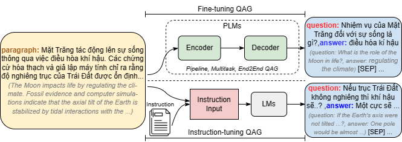
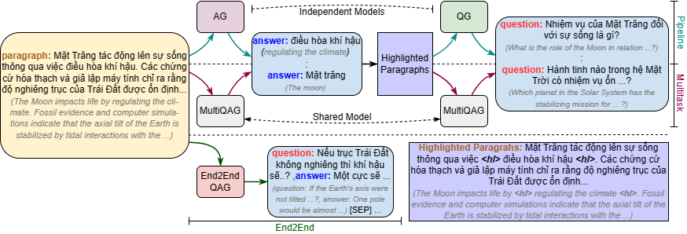

# Hệ thống Sinh Câu Hỏi Trắc Nghiệm Tiếng Việt Tự Động


Đồ án ứng dụng mô hình ngôn ngữ lớn (PLM + LLM) vào bài toán sinh câu hỏi trắc nghiệm (Multiple Choice Question Generation) cho văn bản tiếng Việt.

## ⚡ Chạy nhanh (5 dòng)

```bash
git clone https://github.com/haibadguy/ViT5.git
cd ViT5
python -m venv .venv && .venv\Scripts\activate     # macOS/Linux: source .venv/bin/activate
pip install -r demo_mcq/requirements.txt
copy demo_mcq\.env.example demo_mcq\.env            # cp trên macOS/Linux, rồi điền 1 API key
streamlit run demo_mcq/app.py
```

Cần **một** key LLM bất kỳ (Gemini / OpenAI / Groq) hoặc Ollama local — xem bảng bên dưới.



> Quay một GIF thao tác thật rồi lưu tại `docs/demo.gif` để minh họa UI
> Streamlit; ảnh kiến trúc ở trên giúp repo vẫn có hình xem ngay sau khi clone.

ViT5 sinh câu hỏi và đáp án đúng từ văn bản tiếng Việt. Gemini, GPT, Groq hoặc
Ollama chỉ sinh các đáp án nhiễu, sau đó ứng dụng chuẩn hóa và xáo trộn thành
MCQ. Xem định dạng đầu ra mẫu tại [`docs/sample_output.json`](docs/sample_output.json).

Pipeline gồm 2 giai đoạn:

```
Đoạn văn tiếng Việt
        │
        ▼  Stage 1 – ViQAG (ViT5 fine-tuned)
        ├─ AE: "extract answers: ..."    →  đáp án ứng viên
        └─ QG: "generate question: ..."  →  câu hỏi
        │
        ▼  Stage 2 – LLM (Gemini / GPT / Ollama)
        └─ Sinh 3–4 đáp án sai (distractors) cho mỗi câu
        │
        ▼  Build MCQ
        └─ 4 lựa chọn A / B / C / D  ·  xáo ngẫu nhiên
        │
        ▼  Streamlit Web App  (demo_mcq/)
        └─ Chỉnh sửa · Lưu lịch sử · Xuất Word / PDF
```

> **Nghiên cứu nền tảng:**
> Pham, Q.-H., Le, H.-L., Dang, N. M., Tran, K. T., Tran-Tien, M., Dang, V.-H., Vu, H.-T., Nguyen, M.-T., & Phan, X.-H. (2024).
> *Towards Vietnamese Question and Answer Generation: An Empirical Study.*
> ACM Transactions on Asian and Low-Resource Language Information Processing.
> https://doi.org/10.1145/3675781

> **Codebase gốc (ViQAG):** https://github.com/Shaun-le/ViQAG
> Repo này kế thừa và mở rộng phần demo với distractor generation và giao diện Streamlit.

---

## 🤖 Chọn backend LLM

Stage 2 (sinh đáp án nhiễu) cần **một** backend. Đặt key trong `demo_mcq/.env`
rồi chọn `LLM_BACKEND` (hoặc để `auto` — app tự dò theo key có sẵn).

| Backend | Cần gì | Dùng khi nào | Chi phí |
|---|---|---|---|
| **Gemini** | `GEMINI_API_KEY` | Mặc định, nhanh, free tier | Free tier |
| **OpenAI** | `OPENAI_API_KEY` | Cần chất lượng cao nhất | Trả phí |
| **Groq** | `GROQ_API_KEY` | Cần tốc độ cao, free tier | Free tier |
| **Ollama** | Cài [Ollama](https://ollama.ai) local | Không muốn gửi dữ liệu ra ngoài | Miễn phí |

Danh sách biến môi trường đầy đủ: [`demo_mcq/.env.example`](demo_mcq/.env.example)
(gồm cả `<BACKEND>_MODEL` để đổi model mặc định và `GEMINI_API_KEY_2…` để luân phiên key).

> **Lưu ý:** chế độ *HF Inference API* đã bị bỏ (xem [CHANGELOG.md](CHANGELOG.md)).
> Stage 1 (ViT5) luôn chạy local bằng `torch` + `transformers`.

---

## 📦 Cấu trúc repo

```
ViT5/
├── plms/                    # Thư viện core (kế thừa từ ViQAG)
│   ├── language_model.py       ← class TransformersQG (QG / QAG / AE)
│   ├── inference_api.py        ← HF Inference API wrapper
│   ├── trainer.py              ← training loop
│   ├── compute_metrics.py      ← BLEU, ROUGE, BERTScore
│   ├── data.py
│   └── utils.py
├── llm/                     # LLM-based generation
│   ├── generate.py
│   └── trainer.py
├── data/                    # Tiện ích xử lý dữ liệu & JSONL mẫu
│   ├── qg_data.py
│   ├── qag_data.py
│   ├── instructions.txt
│   └── examples/
├── assets/
├── train.py                 # Script fine-tuning PLM
├── evaluation.py            # Script đánh giá (BLEU / ROUGE / BERTScore)
├── requirements.txt
│
└── demo_mcq/                # ★ Web App Demo
    ├── app.py                  ← Streamlit UI (entry point)
    ├── generator.py            ← Stage 1: ViQAG pipeline wrapper
    ├── distractor.py           ← Stage 2: LLM distractor generator
    ├── schema.py               ← Kiểu dữ liệu MCQ + validate
    ├── export_utils.py         ← Xuất Word / PDF / TXT / JSON / CSV
    ├── assets/fonts/           ← DejaVuSans (nhúng cho PDF tiếng Việt)
    ├── .env                    ← API keys (tạo từ .env.example)
    ├── .env.example
    ├── requirements.txt
    └── requirements-dev.txt
├── tests/                    # pytest (chạy offline, không gọi API)
└── .github/workflows/        # CI: ruff + pytest --cov
```

---

## 🚀 Chạy Web App Demo

### 1. Clone repo

```bash
git clone https://github.com/haibadguy/ViT5.git
cd ViT5/demo_mcq
```

### 2. Cài thư viện

```bash
# PyTorch CPU (đủ cho demo, không cần GPU)
pip install torch --index-url https://download.pytorch.org/whl/cpu

# Thư viện demo
pip install -r requirements.txt
```

<details>
<summary>requirements.txt (demo_mcq)</summary>

```
streamlit>=1.32.0
python-dotenv>=1.0.0
torch>=2.1.0
transformers>=4.38.0
sentencepiece>=0.1.99
accelerate>=0.27.0
google-genai>=1.0.0
openai>=1.12.0
python-docx>=1.1.0
fpdf2>=2.7.9
```
</details>

### 3. Tạo file `.env`

```bash
copy .env.example .env   # Windows
cp .env.example .env     # Mac / Linux
```

Điền vào `.env`:

```env
# Model sinh Q-A (tải tự động lần đầu ~900 MB)
VIQAG_MODEL=shnl/vit5-vinewsqa-qg-ae

# HuggingFace token (chỉ cần khi dùng HF Inference API)
HF_TOKEN=your_huggingface_token_here

# Gemini API key – lấy tại https://aistudio.google.com/app/apikey
GEMINI_API_KEY=your_gemini_api_key_here
GEMINI_MODEL=gemini-2.5-flash-lite
```

### 4. Khởi động

```bash
streamlit run app.py
```

Truy cập: **http://localhost:8501**

### Tính năng demo

| Tính năng | Mô tả |
|---|---|
| Sinh MCQ từ văn bản | Nhập đoạn văn → tự động ra câu hỏi trắc nghiệm 4 lựa chọn |
| Số câu tuỳ chỉnh | Chọn 1–20 câu |
| Độ khó distractor | Dễ / Trung bình / Khó |
| Chỉnh sửa nội tuyến | Sửa câu hỏi, đáp án trực tiếp trên UI |
| Lịch sử | Lưu lại 10 đề gần nhất trong session |
| Xuất Word (.docx) | Đề + bảng đáp án, có highlight đáp án đúng |
| Xuất PDF | Font hỗ trợ Unicode tiếng Việt |
| Fallback | Nếu Gemini lỗi, vẫn hiển thị câu hỏi với placeholder |

---

## 🧠 Mô hình sử dụng

### Stage 1 – ViT5 (Question & Answer Generation)

Model chính: [`shnl/vit5-vinewsqa-qg-ae`](https://huggingface.co/shnl/vit5-vinewsqa-qg-ae)
— Multitask model (QG + AE cùng 1 model), fine-tuned trên ViNewsQA.

**Kiến trúc:** ViT5 là biến thể T5 cho tiếng Việt, được phát triển bởi VietAI [[2]](#references).
Input sử dụng prefix để phân biệt subtask:

```
# Answer Extraction
"extract answers: {context_before} <hl> {sentence} <hl> {context_after}"

# Question Generation
"generate question: {context_before} <hl> {answer} <hl> {context_after}"
```

Các model khác hỗ trợ:

| Model | Loại | Dataset | Link |
|---|---|---|---|
| `shnl/vit5-vinewsqa-qg-ae` | Multitask QG+AE | ViNewsQA | [HF](https://huggingface.co/shnl/vit5-vinewsqa-qg-ae) |
| `namngo/pipeline-vit5-viquad-qg` | Pipeline QG | ViQuAD | [HF](https://huggingface.co/namngo/pipeline-vit5-viquad-qg) |
| `namngo/pipeline-vit5-viquad-ae` | Pipeline AE | ViQuAD | [HF](https://huggingface.co/namngo/pipeline-vit5-viquad-ae) |

### Stage 2 – LLM (Distractor Generation)

Mặc định dùng **Gemini 2.5 Flash Lite** qua `google-genai` SDK [[6]](#references).
Cũng hỗ trợ OpenAI GPT và Ollama (local).

---

## 📐 Công thức toán học

Bài toán QAG được phát biểu là: cho đoạn văn $C = \{s_1, s_2, \ldots, s_n\}$ gồm $n$ câu, mô hình cần sinh ra tập cặp hỏi-đáp

$$\mathcal{Q} = \{(q_1, a_1),\ (q_2, a_2),\ \ldots\}$$

như một quá trình sinh có điều kiện:

$$\mathcal{Q} = f(Q \mid C,\ \theta)$$

trong đó $Q$ là các cặp QA gold trong tập huấn luyện, $f(\cdot)$ là mô hình encoder-decoder, và $\theta$ là tham số mô hình được học qua fine-tuning.

<figure>
  <p align="center">
    
  </p>
  <p align="center"><strong>Fig. 1 – Tổng quan hệ thống fine-tuning và instruction-tuning cho QAG (Pham et al., 2024).</strong></p>
</figure>

---

## 📖 Dùng như thư viện Python

### Cài đặt

```bash
git clone https://github.com/haibadguy/ViT5.git
cd ViT5
pip install -r requirements.txt
```

### Pipeline model (QG + AE riêng biệt)

```python
from plms.language_model import TransformersQG

model = TransformersQG(
    model='namngo/pipeline-vit5-viquad-qg',
    model_ae='namngo/pipeline-vit5-viquad-ae'
)

context = (
    'Lê Lợi sinh ra trong một gia đình hào trưởng tại Thanh Hóa, trưởng thành trong thời kỳ Nhà Minh đô hộ nước Việt.'
    'Năm 1418, Lê Lợi tổ chức cuộc khởi nghĩa Lam Sơn với lực lượng ban đầu chỉ khoảng vài nghìn người.'
    'Thời gian đầu ông hoạt động ở vùng thượng du Thanh Hóa, quân Minh đã huy động lực lượng tới hàng vạn quân để đàn áp,'
    'nhưng bằng chiến thuật trốn tránh hoặc sử dụng chiến thuật phục kích và hòa hoãn, nghĩa quân Lam Sơn đã dần lớn mạnh.'
)

qa = model.generate_qa(context)
print(qa)
# [
#   ('Quân Minh đã huy động bao nhiêu quân để đàn áp?', 'hàng vạn quân'),
#   ('Lê Lợi đã làm gì vào năm 1418?', 'tổ chức cuộc khởi nghĩa Lam Sơn'),
# ]
```

### Multitask / End-to-End model

```python
from plms.language_model import TransformersQG

model = TransformersQG(model='shnl/vit5-vinewsqa-qg-ae')
qa    = model.generate_qa(context)
```

### Chỉ sinh câu hỏi (QG Only)

```python
from plms.language_model import TransformersQG

model   = TransformersQG(model='namngo/pipeline-vit5-viquad-qg')
context = ['Năm 1418, Lê Lợi tổ chức cuộc khởi nghĩa Lam Sơn...']
answer  = ['Năm 1418']

questions = model.generate_q(list_context=context, list_answer=answer)
# ['Cuộc khởi nghĩa Lam Sơn nổ ra vào năm nào?']
```

### Chỉ trích xuất đáp án (AE Only)

```python
from plms.language_model import TransformersQG

model  = TransformersQG(model='namngo/pipeline-vit5-viquad-ae')
answer = model.generate_a(context)
# ['Lê Lợi', 'tổ chức cuộc khởi nghĩa Lam Sơn', 'hàng vạn quân']
```

---

## ⚙️ Huấn luyện mô hình

### Chuẩn bị dữ liệu

Dữ liệu cần ở định dạng `.jsonl`. Xem mẫu tại [`data/examples/`](data/examples/).

```bash
# Pipeline / Multitask
python ./data/qg_data.py process_data \
    --input_dir  'path/to/input' \
    --output_dir 'path/to/output'

# End2End / Instruction
python ./data/qag_data.py process_data \
    --input_dir        'path/to/input' \
    --output_dir       'path/to/output' \
    --instruction_path 'data/instructions.txt'
```

### Fine-tuning

```bash
# AE (Answer Extraction)
python train.py fine-tuning \
    --model 'VietAI/vit5-base' \
    --dataset_path 'shnl/qg-example' \
    --input_types 'paragraph_sentence' \
    --output_types 'answer' \
    --prefix_types 'ae'

# QG (Question Generation)
python train.py fine-tuning \
    --model 'VietAI/vit5-base' \
    --dataset_path 'shnl/qg-example' \
    --input_types 'paragraph_answer' \
    --output_types 'question' \
    --prefix_types 'qg'

# Multitask (QG + AE cùng lúc)
python train.py fine-tuning \
    --model 'VietAI/vit5-base' \
    --dataset_path 'shnl/qg-example'

# End2End (QAG)
python train.py fine-tuning \
    --model 'VietAI/vit5-base' \
    --dataset_path 'shnl/qag-example' \
    --prefix_types 'qag' \
    --input_types 'paragraph' \
    --output_types 'questions_answers'
```

<figure>
  <p align="center">
    
  </p>
  <p align="center"><strong>Fig. 2 – Các phương pháp fine-tuning: Pipeline, Multitask, End2End (Pham et al., 2024).</strong></p>
</figure>

### Đánh giá

```bash
python evaluation.py evaluate --result_path 'result.json'
```

Các metric được tính: BLEU-4, ROUGE-L, BERTScore (F1).

---

## 🛠️ Xử lý lỗi thường gặp

| Lỗi | Nguyên nhân | Cách xử lý |
|---|---|---|
| `CUDA out of memory` | GPU không đủ VRAM | Thêm `device='cpu'` hoặc dùng `VIQAG_MODEL` nhỏ hơn |
| `Token length exceeded` | Context quá dài | Rút ngắn dưới 400 từ |
| `JSONDecodeError` (distractor) | LLM trả về format lạ | Đã auto-fallback trong `distractor.py` (test: `tests/test_parser.py`) |
| `429 RESOURCE_EXHAUSTED` / quota | Hết quota free tier | App đã retry + luân phiên key; đợi ~1 phút hoặc đổi backend (Groq) |
| `401` / `API key not valid` | Key sai hoặc đã bị thu hồi | Tạo key mới, cập nhật `.env`, khởi động lại app |
| `Connection refused` (Ollama) | Chưa chạy server | Chạy `ollama serve` rồi kiểm tra `OLLAMA_HOST` |
| Câu hỏi ra tiếng Anh | Sai model | Dùng model fine-tuned tiếng Việt (xem bảng trên) |
| PDF mất dấu `Đ`, `ắ`, `ộ`… | Thiếu font Unicode | Repo đã nhúng `demo_mcq/assets/fonts/DejaVuSans.ttf`; nếu vẫn lỗi, cài `fonts-dejavu-core` |
| `label got an empty value` (Streamlit) | `st.checkbox("")` | Đã sửa thành label ẩn có nội dung |

> Lỗi từ backend được hiển thị qua `friendly_llm_error()` (401/429/timeout/CUDA) và
> **API key luôn được mask** (`mask_key`, `scrub_secrets`) — không in ra UI hay log.

---

## ✅ Kiểm thử & CI

```bash
pip install -r demo_mcq/requirements-dev.txt
pytest -q                 # 36 test, chạy offline (không gọi API, không tải model)
ruff check .              # lint
```

CI chạy tự động trên GitHub Actions với Python 3.10 và 3.12:
[`.github/workflows/tests.yml`](.github/workflows/tests.yml).

| File test | Nội dung |
|---|---|
| `tests/test_schema.py` | Validate MCQ: thiếu lựa chọn, trùng, index sai, round-trip dict |
| `tests/test_parser.py` | Parse JSON từ LLM (fence, chatty, fallback) + parse bộ đề JSON |
| `tests/test_export.py` | Word / PDF / TXT / JSON / CSV — kiểm tra dấu tiếng Việt & trang đáp án |
| `tests/test_generator.py` | `QAGenerator` với `_load_local` bị mock (không cần torch) |
| `tests/test_distractor.py` | Parse distractor + chọn backend + override model qua env |

---

## ⚠️ Giới hạn đã biết

- **Chất lượng câu hỏi phụ thuộc model ViT5** (`shnl/vit5-vinewsqa-qg-ae`): có thể sinh
  câu trùng ý hoặc đáp án quá dài. App đã lọc Jaccard + kiểm tra answer leakage, nhưng
  giáo viên **vẫn cần rà soát** trước khi dùng.
- **Đáp án nhiễu do LLM sinh** có thể trùng nhau hoặc quá dễ; câu không hợp lệ bị loại
  tự động (`schema.validate`, hiển thị số câu giữ/loại trên UI).
- **Export PDF** cần font Unicode; repo có sẵn DejaVuSans (giấy phép Bitstream Vera, cho
  phép nhúng). Môi trường không có font nào sẽ báo lỗi rõ ràng thay vì xuất PDF mất dấu.
- **Chưa có benchmark định lượng** (chưa đo tỉ lệ câu dùng được / độ nhiễu).
- **Chi phí API**: Gemini/Groq free tier có giới hạn request; OpenAI tính phí theo token.
- **Không gửi dữ liệu nhạy cảm** lên LLM cloud; dùng Ollama nếu cần giữ dữ liệu nội bộ.
- **UI chưa có** lưu/tải bộ đề JSON từ file và form metadata đề thi (đang ở roadmap).

---

## 📚 References

<a id="references"></a>

**[1]** Pham, Q.-H., Le, H.-L., Dang, N. M., Tran, K. T., Tran-Tien, M., Dang, V.-H., Vu, H.-T., Nguyen, M.-T., & Phan, X.-H. (2024). *Towards Vietnamese Question and Answer Generation: An Empirical Study.* ACM Transactions on Asian and Low-Resource Language Information Processing. https://doi.org/10.1145/3675781

**[2]** Phan, L. T., Tran, H., Nguyen, H., & Trinh, T. H. (2022). *ViT5: Pretrained Text-to-Text Transformer for Vietnamese Language Generation.* Proceedings of NAACL-HLT 2022 (Student Research Workshop). https://aclanthology.org/2022.naacl-srw.18

**[3]** Raffel, C., Shazeer, N., Roberts, A., Lee, K., Narang, S., Matena, M., Zhou, Y., Li, W., & Liu, P. J. (2020). *Exploring the Limits of Transfer Learning with a Unified Text-to-Text Transformer.* Journal of Machine Learning Research, 21(140), 1–67. https://jmlr.org/papers/v21/20-1307.html

**[4]** Nguyen, K., Nguyen, V. D., Nguyen, A. G.-T., & Nguyen, N. L.-T. (2020). *A Vietnamese Dataset for Evaluating Machine Reading Comprehension (ViQuAD).* Proceedings of COLING 2020. https://aclanthology.org/2020.coling-main.233

**[5]** Wolf, T., Debut, L., Sanh, V., Chaumond, J., Delangue, C., Moi, A., … Brew, J. (2020). *Transformers: State-of-the-Art Natural Language Processing.* Proceedings of EMNLP 2020 (System Demonstrations). https://aclanthology.org/2020.emnlp-demos.6

**[6]** Google DeepMind. (2024). *Gemini: A Family of Highly Capable Multimodal Models.* https://deepmind.google/technologies/gemini/

**[7]** Streamlit Inc. (2024). *Streamlit – A faster way to build and share data apps.* https://streamlit.io

**[8]** ViQAG original codebase: https://github.com/Shaun-le/ViQAG

**[9]** `shnl/vit5-vinewsqa-qg-ae` model: https://huggingface.co/shnl/vit5-vinewsqa-qg-ae

**[10]** `VietAI/vit5-base` pretrained model: https://huggingface.co/VietAI/vit5-base

---

## Citation

Nếu bạn sử dụng nghiên cứu gốc trong công trình của mình, vui lòng trích dẫn:

```bibtex
@article{pham2024towards,
  title     = {Towards Vietnamese Question and Answer Generation: An Empirical Study},
  author    = {Pham, Quoc-Hung and Le, Huu-Loi and Dang Nhat, Minh and Tran T, Khang
               and Tran-Tien, Manh and Dang, Viet-Hung and Vu, Huy-The
               and Nguyen, Minh-Tien and Phan, Xuan-Hieu},
  journal   = {ACM Transactions on Asian and Low-Resource Language Information Processing},
  year      = {2024},
  publisher = {ACM New York, NY},
  doi       = {10.1145/3675781}
}
```
