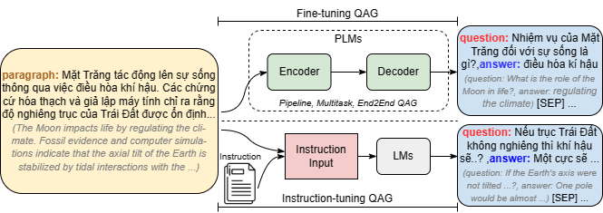

# 📝 Vietnamese MCQ Generator – Demo App

Web app sinh câu hỏi trắc nghiệm tiếng Việt cho giáo viên, chạy bằng **Streamlit**.

```
Đoạn văn  →  ViQAG (ViT5)  →  Q+A  →  LLM  →  Distractors  →  MCQ  →  Export
```



> Có thể lưu GIF thao tác Streamlit tại `../docs/demo.gif` sau khi quay demo thật.

ViT5 chịu trách nhiệm sinh câu hỏi và đáp án đúng từ văn bản tiếng Việt.
Gemini, GPT, Groq hoặc Ollama chỉ sinh các đáp án nhiễu; chúng không thay thế
giai đoạn sinh câu hỏi của ViT5.

---

## 🚀 Chạy nhanh (3 bước)

### Bước 1 – Cài thư viện

```bash
cd demo_mcq

# PyTorch CPU-only
pip install torch --index-url https://download.pytorch.org/whl/cpu

# Các thư viện còn lại
pip install -r requirements.txt
```

### Bước 2 – Tạo file `.env`

```bash
copy .env.example .env    # Windows
# cp .env.example .env    # Mac/Linux
```

Điền vào `.env`:

```env
VIQAG_MODEL=shnl/vit5-vinewsqa-qg-ae
HF_TOKEN=your_huggingface_token_here     # huggingface.co/settings/tokens

GEMINI_API_KEY=your_gemini_api_key_here
# OPENAI_API_KEY=your_openai_api_key_here
# OLLAMA_HOST=http://localhost:11434
```

Chỉ cần **một** key LLM (Gemini / OpenAI / Ollama).

### Bước 3 – Khởi động Streamlit

```bash
streamlit run app.py
```

→ Mở **http://localhost:8501**

---

## 📂 Cấu trúc

```
demo_mcq/
├── app.py              # Streamlit UI – entry point
├── generator.py        # Stage 1: ViQAG (ViT5) sinh Q-A
├── distractor.py       # Stage 2: LLM sinh distractors
├── schema.py           # Kiểu dữ liệu MCQ + validate
├── export_utils.py     # Xuất Word / PDF / TXT / JSON / CSV
├── assets/fonts/       # DejaVuSans nhúng sẵn cho PDF tiếng Việt
├── requirements.txt
├── requirements-dev.txt
├── .env                # API keys (tạo từ .env.example)
└── .env.example
```

---

## 🧩 Kiến trúc

### Stage 1 – `generator.py` (ViT5, chạy local)

| Điều kiện | Yêu cầu | Tốc độ |
|---|---|---|
| Model local | ~1 GB RAM (CPU đủ dùng) | Nhanh sau lần tải đầu |

Model mặc định: `shnl/vit5-vinewsqa-qg-ae`. `HF_TOKEN` chỉ cần khi model gated/private.
> Chế độ *HF Inference API* đã bị bỏ — model ViT5 tiếng Việt không khả dụng qua API đó.

### Stage 2 – `distractor.py` (LLM)

| Backend | Model mặc định | Setup | Chi phí |
|---|---|---|---|
| **Gemini** | `gemini-2.5-flash-lite` | `GEMINI_API_KEY` | Free tier |
| **OpenAI** | `gpt-4o-mini` | `OPENAI_API_KEY` | Trả phí |
| **Groq** | `llama-3.3-70b-versatile` | `GROQ_API_KEY` | Free tier |
| **Ollama** | `llama3` | `ollama serve` | Miễn phí |

Chọn backend bằng `LLM_BACKEND` trong `.env` (hoặc `auto` = tự dò theo key có sẵn).
Đổi model bằng `<BACKEND>_MODEL` (vd `GROQ_MODEL`).

---

## ✏️ Tính năng chỉnh sửa

- Chỉnh nội dung câu hỏi và đáp án trực tiếp
- Đổi đáp án đúng bằng một click
- Xóa / Thêm câu
- Regenerate distractors cho từng câu riêng lẻ
- Xáo thứ tự A/B/C/D
- Chọn câu để xuất (checkbox)
- Lịch sử 10 đề gần nhất
- Hiển thị số câu sinh ra / giữ lại sau validate (kèm lý do loại)

## 📤 Export

| Định dạng | Nội dung |
|---|---|
| **Word (.docx)** | Đề sạch + trang đáp án riêng |
| **PDF** | Đề sạch + trang đáp án riêng (font DejaVu nhúng) |
| **TXT** | Kèm bảng đáp án ở cuối |
| **JSON** | Format chuẩn (`correct_index`), import lại được |
| **CSV** | Template Quizizz / Google Forms (UTF-8 BOM) |

---

## 🐛 Lỗi thường gặp

| Lỗi | Fix |
|---|---|
| `CUDA out of memory` | Chạy CPU hoặc dùng `VIQAG_MODEL` nhỏ hơn |
| `JSONDecodeError` | `distractor.py` tự fallback (test: `tests/test_parser.py`) |
| `429` / quota | App retry + luân phiên key (`GEMINI_API_KEY_2`), hoặc đổi backend |
| `401` / key invalid | Tạo key mới, cập nhật `.env` |
| `Connection refused` (Ollama) | `ollama serve` |
| Câu hỏi tiếng Anh | Đổi sang model fine-tuned tiếng Việt (`shnl/vit5-vinewsqa-qg-ae`) |
| ViQAG sinh 0 câu | Văn bản quá ngắn (<3 câu) hoặc model gated thiếu `HF_TOKEN` |
| PDF mất dấu | Repo đã nhúng `assets/fonts/DejaVuSans.ttf`; kiểm tra file còn tồn tại |

---

## ✅ Test

```bash
pip install -r requirements-dev.txt
cd .. && pytest -q      # 49 test, chạy offline
```

Xem thêm [`../README.md`](../README.md) (kiến trúc, giới hạn, CI) và
[`../CHANGELOG.md`](../CHANGELOG.md).


